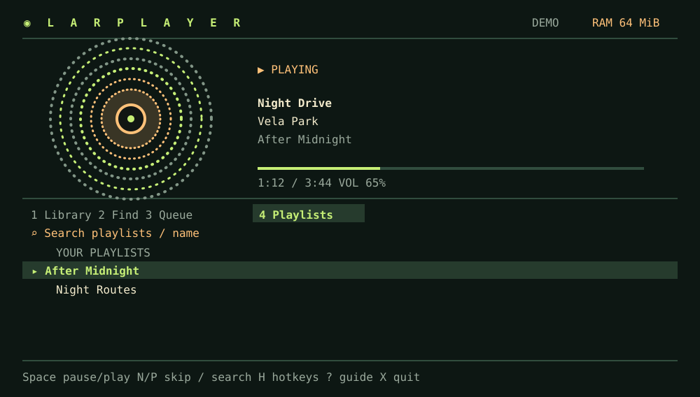

# LARPlayer



## The more you larp, the less you larp...
A native Windows terminal player with a spinning record, live track information, saved-library search, playlists, configurable global hotkeys and a RAM meter. Spotify Soloist handles the audio. Spotify Desktop can stay closed.

Windows 10/11 x64, a terminal with VT support, and a personal Spotify Premium account are required for playback. The application is written in C++20 and builds with Visual Studio's x64 C++ tools and Windows SDK.

The top-right RAM figure updates about every two seconds. It adds LARPlayer's and Spotify Soloist's Windows working sets while the live receiver is available. The terminal is excluded, and shared memory can appear in both process counts.

## Open the deck

Download a Windows build artifact from the Actions tab or build from source below. Extract the ZIP and open `LARPlayer.exe`. It starts Spotify Soloist and the turntable together. If you already paired LARPlayer, it uses your saved setup, activates the Spotify Connect device, and starts playback. It resumes a paused track or starts your last played track. On a fresh profile with a saved music cache, it plays the first saved track. A terminal at least 57 columns wide and 24 rows tall shows the full turntable. Smaller windows use a compact layout.

On a first installation, LARPlayer downloads Soloist directly from Spotify. Create a personal key with your Spotify Premium account and paste it into the hidden prompt. LARPlayer stores it in Windows Credential Manager. Start music in Spotify on your phone, open its device picker and select **LARPlayer**. Keep the phone and PC on the same network for pairing. [Spotify Soloist dashboard](https://developer.spotify.com/dashboard/soloist)

## Keys

| Key | Action |
| --- | --- |
| **1** | Browse music cached in the local LARPlayer library |
| **2** | Open Find to filter saved music or paste a Spotify link |
| **3** | Show the upcoming queue |
| **4** | Browse your saved playlists in their own section |
| **/** or **Ctrl+F** | Focus the search box on the current section and filter results as you type |
| **↑**, **↓**, **PgUp**, **PgDn** | Move the selection |
| **Enter** | Play the selection or pasted link |
| **Space** | Pause or resume |
| **N** / **P** | Next or previous track |
| **+** / **−** | Raise or lower volume by five percentage points |
| **V** | Check for a signal in Soloist’s Windows audio session |
| **F1 / F2 / F3** | Pause or resume / previous track / next track, including while another app has focus |
| **H** | Reassign the three global playback shortcuts |
| **Esc** | Finish typing in the search box or dismiss help |
| **?** / **X** | Show the keys or quit the deck |

The Library search box accepts song titles and artist names. Results update with every keypress, and Enter plays the selected result. The Playlists tab lists saved playlists from your local cache and has its own name filter. Press Ctrl+U while typing to clear a query. Search and Find also accept Spotify track, album, playlist and episode links. Search by name uses the classic client’s local saved library. On a new profile, paste a link or use Spotify on your phone to search the full catalog. The deck updates when you change tracks from your phone.

Keep LARPlayer open while playing a game to use its system-wide F1, F2 and F3 shortcuts. Press H in the deck, choose 1, 2 or 3, then press a replacement function key from F1 through F11 with optional Ctrl, Alt, Shift or Win. The binding is saved for your Windows profile. Press 4 on that screen to restore the defaults. Some games or other apps may reserve a key and prevent its registration. The hotkey screen marks unavailable bindings so you can choose another combination. If your keyboard sends dedicated media keys from its function row, Play/Pause, Previous and Next are also handled when Windows delivers them to LARPlayer.

## Other commands

- `.\LARPlayer.exe ram` shows Windows working sets for LARPlayer, Soloist and Spotify Desktop. Run it in a second terminal while music plays. The terminal and measurement command are excluded. Shared pages can count twice.
- `.\LARPlayer.exe demo` opens an interactive preview with sample tracks and simulated playback.
- `.\LARPlayer.exe playlists`, `.\LARPlayer.exe search` and `.\LARPlayer.exe queue` open those deck views directly.
- `.\LARPlayer.exe commands` opens the line-based player. Type `ui` to enter the full-screen deck.
- `.\LARPlayer.exe key` replaces the saved Soloist key. Quit the receiver and run `.\LARPlayer.exe update` to refresh an expired engine.
- `.\LARPlayer.exe doctor` prints the engine versions and profile paths. If setup cannot reach Spotify, extract its official Windows ZIP into `engine\soloist` beside the launcher. [Official downloads](https://developer.spotify.com/documentation/soloist/reference/downloads-and-updates)
- `.\LARPlayer.exe classic` opens ncspot, included for access to its library and settings.

## Build and check

Install Visual Studio with the Desktop development with C++ workload and Windows SDK. From PowerShell in the repository root, run

```powershell
.\scripts\build.ps1
.\scripts\smoke.ps1
```

The build writes `dist\LARPlayer\LARPlayer.exe` and `dist\LARPlayer-Windows-x64.zip`. Open the EXE in the release folder to run it locally. GitHub Actions builds and checks the same ZIP on Windows for each push and pull request. The smoke check covers the offline CLI and ZIP layout. Playback also needs a signed-in user and a manual audio check.

The C++ sources are under `src`, the three classic client configurations are under `settings`, and an interface preview is under `docs`. The optional ncspot 1.5.1 executable is included under `engine` with its BSD 2-Clause license. LARPlayer's own source is MIT licensed. Spotify Soloist is downloaded from Spotify on each user's first setup and is distributed separately. [ncspot release](https://github.com/hrkfdn/ncspot/releases/tag/v1.5.1) · [Spotify Soloist documentation](https://developer.spotify.com/documentation/soloist)

Existing Groove Dial installations continue to use their saved profile and Soloist key. Fresh installations store data under `%LOCALAPPDATA%\LARPlayer`. The old `GROOVE_PROFILE` and `GROOVE_SOLOIST_EXE` environment overrides still work; `LARPLAYER_PROFILE` and `LARPLAYER_SOLOIST_EXE` take precedence.
